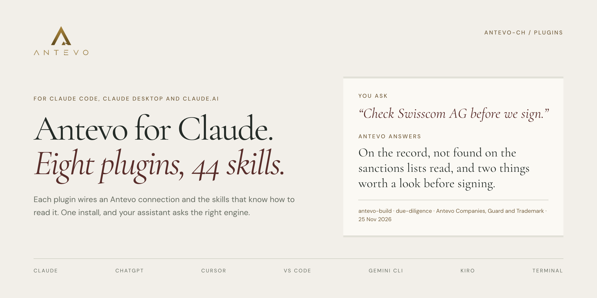
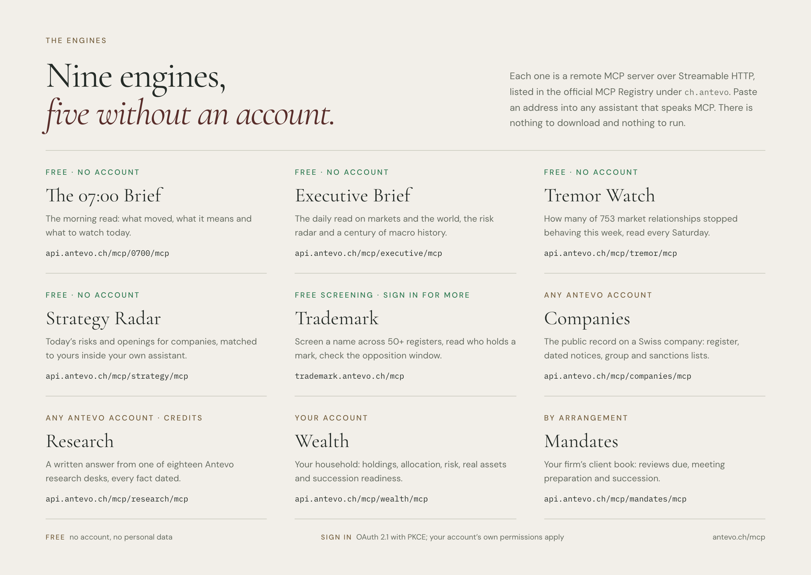
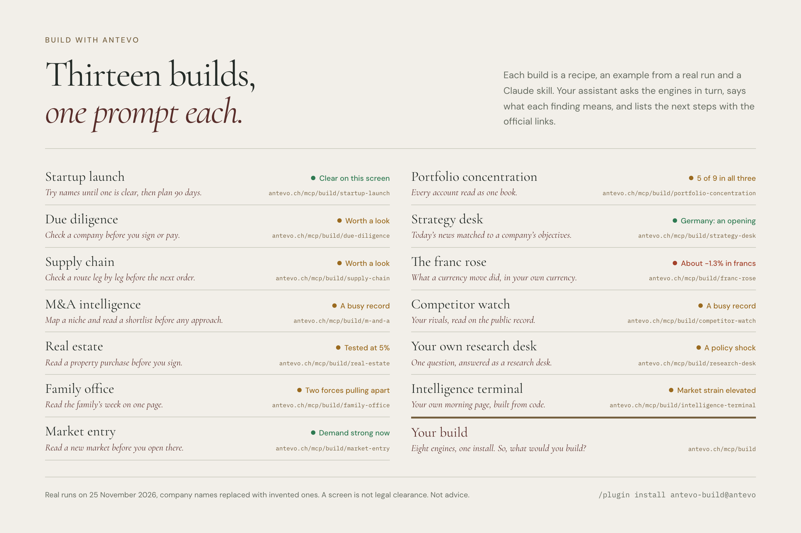
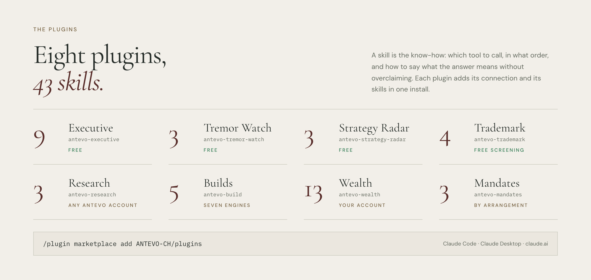

<picture>
  <source media="(prefers-color-scheme: dark)" srcset="assets/cover-plugins-dark.png">
  
</picture>

# Antevo for Claude: plugins, skills and builds

**Eight plugins and 51 skills that bring Antevo into the assistant you already use.** Each plugin wires one Antevo connection (the Executive Brief, the weekly Tremor index, Strategy Radar's daily business board, Antevo's research desks, the trademark registers, your own household or your firm's client book) together with the skills that know how to read it. `antevo-build` adds thirteen builds on top, from Startup Launch Intelligence and Company Due Diligence to Portfolio Concentration, Strategy Desk and your own Intelligence Terminal. Every answer is dated, attributed, and honest about what it cannot see.

[](https://github.com/ANTEVO-CH/plugins/actions/workflows/validate.yml)
[](https://registry.modelcontextprotocol.io/v0/servers?search=ch.antevo)
[](#skills)
[](https://www.npmjs.com/package/@antevo/cli)
[](https://antevo.ch)

```text
/plugin marketplace add ANTEVO-CH/plugins
/plugin install antevo-executive@antevo
```

### Why Antevo

- **A named desk, not a web search.** Answers come from Antevo's published Executive Brief and its dated archive, from the trademark registers themselves, and — when you sign in — from your own record. The assistant says where a read came from and when.
- **Public where it can be, permissioned where it matters.** Executive, Tremor Watch, Strategy Radar and trademark screening need no account and reach no personal data. Wealth, Mandates, Research and Trademark's watchlist and investigations sign in over OAuth 2.1; your account's own permissions apply.
- **Intelligence, not advice.** The skills hold the line: no invented probabilities, no "clear to use", no buy or sell dressed up as a signal.

## The engines

<picture>
  <source media="(prefers-color-scheme: dark)" srcset="assets/engines-dark.png">
  
</picture>

The plugins connect seven of them directly; `antevo-build` connects eight at once: six of them, plus Antevo Guard for checking a payee (`https://api.antevo.ch/mcp/guard/mcp`) and Wealth for your own household. Every address also works on its own in any MCP client: [The connections](#the-connections).

## Build on it

<picture>
  <source media="(prefers-color-scheme: dark)" srcset="assets/builds-dark.png">
  
</picture>

**We build the intelligence. You build what's next.** `antevo-build` connects eight engines in one install and adds builds on top of them. Each build is a recipe, an example from a real run and a skill:

- **Startup Launch Intelligence** (`startup-launch`): tries your names until one is clear, lists the steps to register it with the official links, and plans the first 90 days. [antevo.ch/mcp/build/startup-launch](https://antevo.ch/mcp/build/startup-launch/)
- **Fintech Launch** (`fintech-launch`): plans a Swiss fintech from the name to Germany: the licence route read on FINMA's own pages, rates and the funding window, the strategy in one paragraph, four stages with a gate for each, risks with their triggers and what to measure. [antevo.ch/mcp/build/fintech-launch](https://antevo.ch/mcp/build/fintech-launch/)
- **Strategic Planner** (`strategic-planner`): writes a company's year on every engine: the risk radar and how it moved over sixty days, three scenarios with signposts, Tremor's history and breaks, the business board, supply chains and the calendar; then four stages with gates, a risk register, an early-warning dashboard and the decisions to keep open. Page: [antevo.ch/mcp/build/strategic-planner](https://antevo.ch/mcp/build/strategic-planner/).
- **Invoice Check** (`invoice-check`): checks an invoice with new bank details against the public record before you pay: the company on the register, the email address it came from (a lookalike or not), the country of the bank account, the sanctions lists and recent register changes. It says what does not match and what was not checked, never whether to pay, and it never takes an account number. Page: [antevo.ch/mcp/build/invoice-check](https://antevo.ch/mcp/build/invoice-check/).
- **Company Due Diligence** (`due-diligence`): checks a company before you sign or pay. [antevo.ch/mcp/build/due-diligence](https://antevo.ch/mcp/build/due-diligence/)
- **Supply Chain Watch** (`supply-chain`): checks a supply route leg by leg before the next order. [antevo.ch/mcp/build/supply-chain](https://antevo.ch/mcp/build/supply-chain/)
- **M&A Intelligence** (`m-and-a`): maps a niche and reads a shortlist before any approach. [antevo.ch/mcp/build/m-and-a](https://antevo.ch/mcp/build/m-and-a/)
- **Real Estate Acquisition** (`real-estate`): reads a property purchase before you sign: the seller, the deposit, the market and the mortgage. [antevo.ch/mcp/build/real-estate](https://antevo.ch/mcp/build/real-estate/)
- **Family Office** (`family-office`): reads the week against what a family owns and relies on, and lists what to bring to the family meeting. [antevo.ch/mcp/build/family-office](https://antevo.ch/mcp/build/family-office/)
- **Market Entry** (`market-entry`): reads a new country before you open there: whether your name is free, demand, the trade and export rules and the currency, with the steps before the office opens. [antevo.ch/mcp/build/market-entry](https://antevo.ch/mcp/build/market-entry/)
- **Portfolio Concentration** (`portfolio-concentration`): reads every account as one book: how much sits behind one company, one industry, one country and one currency, and what the accounts did in past crashes. [antevo.ch/mcp/build/portfolio-concentration](https://antevo.ch/mcp/build/portfolio-concentration/)
- **Strategy Desk** (`strategy-desk`): matches today's developments to a company's objectives, with the possible responses and the event that would make each one right. [antevo.ch/mcp/build/strategy-desk](https://antevo.ch/mcp/build/strategy-desk/)
- **The Franc Rose** (`franc-rose`): reads what a currency move did to your money: the book by currency, account by account, this week and this year, and the dates that move it. [antevo.ch/mcp/build/franc-rose](https://antevo.ch/mcp/build/franc-rose/)
- **Competitor Watch** (`competitor-watch`): reads your rivals on the public record: register changes, trademark filings by country and class, and where they meet today's developments. [antevo.ch/mcp/build/competitor-watch](https://antevo.ch/mcp/build/competitor-watch/)
- **Your Own Research Desk** (`research-desk`): answers one question as a research desk: splits it into parts that can be checked, asks the desks that fit, and writes one note with every fact dated. [antevo.ch/mcp/build/research-desk](https://antevo.ch/mcp/build/research-desk/)
- **Intelligence Terminal** (`intelligence-terminal`): builds your own morning terminal on the four free engines: a stdlib Python script that calls them over MCP and writes one page, no account and no model in between. [antevo.ch/mcp/build/intelligence-terminal](https://antevo.ch/mcp/build/intelligence-terminal/)

[How the builds work →](plugins/antevo-build/)

## Who this is for

- **Families and private investors.** One question — *"where could I get hurt this week?"* — traced across concentration, risk, leverage and liquidity in your own household, with the market backdrop that explains it.
- **External asset managers and family offices.** Walk into a client meeting with the dossier, goals, correspondence and the review that is due, prepared from the firm's own record.
- **Founders, brand owners and counsel.** Screen a name before you launch, read who holds anything close and how they file, and know how long you have to oppose.
- **Leadership teams and strategy owners.** *"What changed today for our strategy?"* — the day's risks and opportunities for companies, matched to your markets, inputs, routes and objectives in your own assistant, with possible responses and their reasons. Your answers never reach Antevo.
- **Anyone who follows markets and the world.** The daily editorial read, the risk radar and a century of macro history — no account.

## Table of Contents

- [The engines](#the-engines)
- [Build on it](#build-on-it)
- [Installation](#installation)
- [Quick Start](#quick-start)
- [The connections](#the-connections)
- [Skills](#skills)
- [Features](#features)
- [Compared to asking a chatbot to search](#compared-to-asking-a-chatbot-to-search)
- [Use cases](#use-cases)
- [Sample Output](#sample-output)
- [Methodology](#methodology)
- [What's New](#whats-new)
- [Limitations](#limitations)
- [Requirements](#requirements)
- [Uninstall](#uninstall)
- [Security and privacy](#security-and-privacy)
- [Ecosystem](#ecosystem)
- [FAQ](#faq)
- [License](#license)

## Installation

### Claude — Claude Code, Claude Desktop and claude.ai

Add the marketplace once, then install what you need:

```text
/plugin marketplace add ANTEVO-CH/plugins

/plugin install antevo-executive@antevo    # public — nothing to sign in to
/plugin install antevo-tremor-watch@antevo # public — nothing to sign in to
/plugin install antevo-strategy-radar@antevo # public — your answers stay with Claude
/plugin install antevo-trademark@antevo    # screening public; your watchlist needs a sign-in
/plugin install antevo-research@antevo     # research desks — any Antevo account, OAuth on first use
/plugin install antevo-build@antevo        # thirteen builds on eight engines — five public, three sign in
/plugin install antevo-wealth@antevo       # your household — OAuth on first use
/plugin install antevo-mandates@antevo     # your firm — by arrangement, OAuth on first use
```

Each plugin wires its connection *and* its skills in one step.

### Any MCP client

Every connection is a remote MCP server over Streamable HTTP. Paste an address into Cursor, VS Code, Windsurf, Zed, Goose or any client that speaks MCP — there is nothing to download and nothing to run. One-click links for Cursor and VS Code, and the Gemini CLI extension, live in [ANTEVO-CH/antevo-mcp](https://github.com/ANTEVO-CH/antevo-mcp/blob/main/INSTALL.md).

```bash
gemini extensions install https://github.com/ANTEVO-CH/antevo-mcp
```

### A terminal

```bash
npx @antevo/cli brief    # no account, nothing installed
npx @antevo/cli login    # device code — works over SSH
```

Source: [ANTEVO-CH/cli](https://github.com/ANTEVO-CH/cli).

## Quick Start

No account needed for any of these once `antevo-executive`, `antevo-tremor-watch`, `antevo-strategy-radar` and `antevo-trademark` are installed:

```text
What happened in markets today, and what does the desk make of it?
What could go wrong from here — and what would settle it?
Are markets under strain this week, and how does it compare with 2008?
Set up Strategy Radar for my company — what changed today for our strategy?
Has anyone filed anything close to "Morvane"?
How long do I have to oppose an EU trademark, and from when?
```

With `antevo-research`, `antevo-wealth` or `antevo-mandates` and your sign-in:

```text
What does the rates desk make of the next SNB decision?
What's my brief today?
Where could I get hurt this week?
Which clients are due a review this month?
Prepare me for my meeting with the Birch family.
```

Invoke a skill directly with `/<plugin>:<skill>` — for example `/antevo-executive:risk-radar` — or just ask; the skills trigger on the questions they answer.

## The connections

| | Connection | Address | Access | Tools |
|:--|:--|:--|:--|--:|
| **I.** | **Executive** — the daily editorial read, risk radar, forward calendar, dated archive, per-sector desk reads, a world-events map and macro-economic history | `https://api.antevo.ch/mcp/executive/mcp` | Public | 15 |
| **II.** | **Trademark** — screen a name or a shortlist, read a holder's filing pattern, check an opposition window; with a sign-in, your watchlist, conflicts, deadlines and holder investigations | `https://trademark.antevo.ch/mcp` | Public screening; your desk with a sign-in | 16 |
| **III.** | **Wealth** — your household: holdings, allocation, risk, real assets, liabilities, goals, documents and succession readiness, and recording what you already hold | `https://api.antevo.ch/mcp/wealth/mcp` | Your account | 40 |
| **IV.** | **Mandates** — your firm's client book: clients, reviews, meeting briefs, goals, documents, succession, client email | `https://api.antevo.ch/mcp/mandates/mcp` | By arrangement | 24 |
| **V.** | **Tremor Watch** — every week, how many of 753 market relationships stopped behaving, against a normal Friday since 2001; the families, the new breaks, any week's pairs and every reading since 1997 | `https://api.antevo.ch/mcp/tremor/mcp` | Public | 4 |
| **VI.** | **Strategy Radar** — every morning, the business board of risks and opportunities for companies, with impact, likelihood and trend in words, what to watch and possible responses; matched to your company in your assistant, never at Antevo | `https://api.antevo.ch/mcp/strategy/mcp` | Public | 2 |
| **VII.** | **Research** — put a question to one of eighteen research desks, from the economy and geopolitics to equities, results, ETFs and the Swiss market, and get the desk's written answer with every fact dated; research, never advice | `https://api.antevo.ch/mcp/research/mcp` | Any Antevo account | 1 |

All seven are listed in the official [MCP Registry](https://registry.modelcontextprotocol.io/v0/servers?search=ch.antevo) under `ch.antevo`. Tool counts are read live from each server's `tools/list`.

## Skills

<picture>
  <source media="(prefers-color-scheme: dark)" srcset="assets/plugins-dark.png">
  
</picture>

| Skill | What it does |
|:--|:--|
| **antevo-executive** | *public* |
| `/antevo-executive:world-brief` | What's happening in markets and the world — the editorial read, grounded in the numbers |
| `/antevo-executive:risk-radar` | What could go wrong from here — each risk graded as published, paired with the reading that would settle it |
| `/antevo-executive:emerging-risks` | How the risk board has moved over weeks — new, escalating, entrenched, gone |
| `/antevo-executive:signal-read` | Antevo's own probability layer — live bands only, dated |
| `/antevo-executive:decode` | What a move actually means, in the desk's own plain language |
| `/antevo-executive:story-timeline` | How a story developed, from the dated archive — including where the view shifted |
| `/antevo-executive:desk-read` | Antevo's written view on one area, from shipping and aviation to succession and art |
| `/antevo-executive:world-map` | Chokepoints, conflicts, disasters, displacement, sanctions, cyber, regulatory |
| `/antevo-executive:macro-history` | The long run — prices, rates, house prices and production for about 180 countries |
| **antevo-tremor-watch** | *public* |
| `/antevo-tremor-watch:market-strain` | This week's Tremor index — how many times a normal Friday, its status and rank, and where the breaks gather |
| `/antevo-tremor-watch:what-broke` | The market relationships that stopped behaving — coming apart or moving closer — and what is newly broken |
| `/antevo-tremor-watch:episode-compare` | This week against 2008, 2020 or any period since 1997 |
| **antevo-strategy-radar** | *public* |
| `/antevo-strategy-radar:strategy-setup` | Five questions, no figures, become your company profile — kept in your assistant, never sent to Antevo — then today's board matched to it |
| `/antevo-strategy-radar:strategy-today` | What changed for your strategy today: linked risks and opportunities by impact, each tied to the objective it touches, with possible responses and their reasons |
| `/antevo-strategy-radar:board-read` | The whole business board, today's or any morning in the last 400 days, by theme or exposure, or two mornings compared |
| **antevo-research** | *any Antevo account* |
| `/antevo-research:ask-a-desk` | One question to the desk that covers it, with the answer's dates and how recent its reading is |
| `/antevo-research:joined-up-view` | A question across two or three desks, or the strategy desk, side by side: where they agree and where they differ |
| `/antevo-research:company-read` | A listed company across the equities, results and, on request, technical desks — never a rating or advice |
| **antevo-build** | *five engines public; Companies, Research and Wealth sign in* |
| `/antevo-build:startup-launch` | Tries your names until one is clear, the steps to register it with official links, then the market, costs, competition and funding risk — each with a "so what" — and a 90-day plan |
| `/antevo-build:fintech-launch` | Plans a fintech end to end: the name, the field, the licence route and the rules in the next market, rates, the franc and the funding window, then a twelve-month plan in stages with gates, risks with their triggers, what to measure and the first four weeks with official links |
| `/antevo-build:strategic-planner` | Writes a company's plan for the year: three scenarios with signposts, a risk register from the radar's last sixty days, how unsettled markets are, supply chains, the year in stages with gates, an early-warning dashboard and the decisions to keep open |
| `/antevo-build:invoice-check` | Checks an invoice or a change of bank details before you pay: the company, the email address it came from, the account's country and the record lately, with what does not match and what to confirm yourself |
| `/antevo-build:due-diligence` | Checks a company before you sign or pay: the register, the sanctions lists, its website and email, what changed lately and which group company signs, then what to settle with the official links and what each finding means |
| `/antevo-build:supply-chain` | Checks a supply route leg by leg before the next order: the supplier, export rules at the origin, the sea route, the last mile, fuel and freight, then what to settle with the official links and what each finding means |
| `/antevo-build:m-and-a` | Maps the companies registered in a niche, reads a shortlist one by one (register, notices, brands), lists what to check before a first approach with the official links, and reads the deal climate — financing, currency, demand, market strain |
| `/antevo-build:real-estate` | Reads a property purchase before you sign: the seller in the register, where the deposit goes, the market, the mortgage and the lending rules, the price against history, and what to do before signing with the official links |
| `/antevo-build:family-office` | Reads the week against what a family owns and relies on: each holding against what changed, the risks rising, the scenarios ahead, the firms it relies on in the register, and what to bring to the family meeting with the links |
| `/antevo-build:market-entry` | Reads a new country before you open there: the name screened in its trademark registers, company register and domain, demand, the trade and export rules that touch the product, the currency, and the steps before the office opens with the official links |
| `/antevo-build:portfolio-concentration` | Reads all your accounts as one book: the share behind one company, one industry, one country and one currency, funds looked through, a crash replay per account, and the dates that touch what you hold, never what to buy or sell |
| `/antevo-build:strategy-desk` | Matches today's business board, brief and research desks to your company's three to five objectives: what bears on which objective, where two objectives pull against each other, and the questions for the next meeting with what would settle each |
| `/antevo-build:franc-rose` | Reads what a currency move did to your book in your own currency: the mix by currency and account, the week's and the year's effect, why the currency moved, and the dates ahead, never a hedge recommendation |
| `/antevo-build:competitor-watch` | Reads two to five rivals on the public record: what changed in each register, where and in which classes each files trademarks, what that may point to, and what to watch, never why a notice was filed or whether a company is for sale |
| `/antevo-build:research-desk` | Answers one question as a research desk: splits it into parts, asks the Research desks that fit, sets Tremor Watch against the written answers, and writes one note with where the engines agree and differ and the dates that settle it |
| `/antevo-build:intelligence-terminal` | Builds a custom terminal on the four free engines from code: the MCP handshake, the tools to call, the workspace.json format and scheduling, with a reference Python script (standard library only) in the skill |
| **antevo-trademark** | *screening public* |
| `/antevo-trademark:clearance-check` | What is on the registers near a name, and who holds it — never a clearance |
| `/antevo-trademark:opposition-deadline` | How long there is to oppose in a given office, what starts the clock, and the provision |
| `/antevo-trademark:conflict-review` | New filings near your watched names, ranked by consequence — with your sign-in |
| `/antevo-trademark:holder-investigation` | Who is behind a holder: the register read first, then a cited web dossier that uses a credit, asked first |
| **antevo-wealth** | *your account* |
| `/antevo-wealth:record-holdings` | Records what you already hold, from a statement or a list, after you approve each plan |
| `/antevo-wealth:advisor-meeting-prep` | Before you meet your banker: your book with that bank, what needs attention, the questions to ask |
| `/antevo-wealth:daily-brief` | The household's morning note — what matters today and what needs you |
| `/antevo-wealth:wealth-portfolio-review` | A dated review: net worth, allocation, risk and drift, leverage, real assets |
| `/antevo-wealth:portfolio-stress-radar` | Where you could get hurt — a shock traced through concentration, risk, leverage and liquidity |
| `/antevo-wealth:concentration-and-drift` | Concentration by name, class, currency and region, and drift against target |
| `/antevo-wealth:liquidity-and-leverage` | What can be raised in days, weeks or months, and the headroom to covenant triggers |
| `/antevo-wealth:market-signals-period` | What trended over a window, what's new, where correlations stand |
| `/antevo-wealth:security-analysis` | One instrument through both lenses — fundamentals and technicals |
| `/antevo-wealth:geopolitical-risk` | The world's risks tied to your exposure |
| `/antevo-wealth:watchlist-review` | Your tracked instruments, what moved and why |
| `/antevo-wealth:goals-review` | Funding progress against targets, and the gap to plan |
| `/antevo-wealth:succession-readiness` | If something happened to you tomorrow, what's missing — the readiness band, the first three gaps, who to involve |
| **antevo-mandates** | *by arrangement* |
| `/antevo-mandates:reviews-due` | Overdue first, then the next thirty days by risk tier — and a review recorded only on your go |
| `/antevo-mandates:meeting-prep` | One page to walk in with, from the dossier, goals, team and correspondence |
| `/antevo-mandates:succession-scan` | Where succession planning is thin — clients with no checklist reported as "not started" |

## Features

### What does the Executive connection cover?

The Antevo Executive Brief is a daily editorial read on markets and world events. The connection serves today's brief and the dated archive behind it, the risk radar with each risk's trend, impact and probability *as the desk graded them*, the forward calendar, a market snapshot and indices, fourteen per-sector desk reads, a world-events map in eight layers, and about 80,000 macro-economic reference series for roughly 180 countries. No account, no personal data.

### How does trademark screening work?

`screen_mark` compares a name against the registers Antevo reads and returns each hit with a similarity tier, its status, applicant and filing date, and the registers those hits are filed in. `check_names` does the same for a shortlist of up to 15 names and ranks them, and adds, per name, the companies registered under it (the Swiss register always, the UK and Singapore on request; name and legal form only) and whether its domains are registered. A source that does not answer comes back as not checked. A tier is a string-and-phonetic comparison, not a legal view of confusability. The skills say what exists and what was searched; they never call a name clear, and never call anyone a squatter.

### What can the Wealth connection see?

Only the household your Antevo Wealth sign-in can see — positions and accounts, allocation and drift, risk and stress, real assets, liabilities, goals, family structure and documents — through one connection at `/mcp/wealth/mcp`. Every tool reads, except two: `create_portfolio` and `add_position` record holdings you already own. Each returns a plan first and writes only after you say yes; nothing is ever bought, sold or moved.

### What can the Mandates connection change?

Mandates reaches the signed-in member's own firm. It reads clients, dossiers, reviews, goals, team, documents and client email, and it can also change records in that book: record a review, update a client, assign a team member, set a goal, manage a document, create a time-limited share link to a document. Converting a prospect, deleting a document and creating a share link return a plan first and run only when called again with confirmation, and the skills ask before any change. Access is by arrangement with Antevo.

## Compared to asking a chatbot to search

| | A chatbot searching the web | **Antevo in your assistant** |
|:--|:--|:--|
| **Where the answer comes from** | Whatever pages it finds | **Antevo's published desk, the registers themselves, and — with your sign-in — your own record** |
| **Dated** | Rarely | **Every read carries its date; the archive is addressable by date** |
| **Your holdings or client book** | Not visible | **Visible with your sign-in, scoped to you** |
| **Trademark registers** | Not searched directly | **Screened, with the registers named** |
| **Advice** | Can drift into it | **Intelligence, not advice — the skills hold the line** |

## Use cases

**A family principal before the week starts.** Asks *"where could I get hurt this week?"*. The stress radar reads concentration, risk, leverage and liquidity in the household's own book, pairs each with the market read that explains it, and ends with what could be done before it matters — without placing a trade or moving a franc.

**An external asset manager before a client meeting.** Asks *"prepare me for the Birch family"*. The meeting-prep skill pulls the dossier, goals against target, the review that is due and the correspondence still waiting for a reply, and offers the full generated brief only after saying it uses credits.

**A founder choosing between three names.** Asks *"is any of Morvane, Lumen or Meridian taken?"*. The clearance check screens each, names the registers searched, reads who holds the closest marks and how they file — and leaves the judgement on use to counsel.

**A founder launching a company.** Asks *"help me launch an AI fintech in Switzerland, then Germany — my names are Morvane, Quorvia and Tirano Pay"*. Startup Launch Intelligence walks the names in order: two are taken (an identical EU mark and a Swiss company of the same name), the third is clear on the screen. It lists the steps to register it with the official links, reads the market, costs, competition and funding risk with what each means for the launch, and drafts a 90-day plan. [See the run →](plugins/antevo-build/)

**A buyer about to sign with a new supplier.** Asks *"check Telvaro AG before we sign"*. Company Due Diligence runs five checks in turn — the register, the sanctions lists, the website and email, what changed lately, which group company signs — and marks each on the record or worth a look. It lists what to settle before signing with the official links (today's register extract, the UID, a call on a number you already hold for the bank details), and says what each finding means. Public records only; never a compliance screen. [See the run →](plugins/antevo-build/#company-due-diligence--skill-due-diligence)

**A machine maker before the next order from Asia.** Asks *"check our route for components from Taiwan to Basel before we order"*. Supply Chain Watch walks the route leg by leg — the supplier, leaving the origin, the sea route, Rotterdam and the Rhine, fuel and freight — and marks each running, worth a look, disrupted or not checked. It lists what to settle before the order with the official links (the supplier's register, a price clause, the river gauges, the customs tariff) and says what each finding means. [See the run →](plugins/antevo-build/#supply-chain-watch--skill-supply-chain)

**A buyer looking at a niche.** Asks *"who is in Swiss robotics, and read three of them before we call anyone"*. M&A Intelligence maps the companies registered under the word, reads the shortlist — register, dated notices, group, sanctions lists, who holds which brands — and lists what to check before a first approach with the official links. It ends with the deal climate: financing, the franc, German demand and market strain, each with what it means. It never says a company is for sale. [See the run →](plugins/antevo-build/#ma-intelligence--skill-m-and-a)

**A buyer about to reserve an apartment.** Asks *"I am about to buy a new apartment near Zurich with a mortgage: read the deal before I sign"*. Real Estate Acquisition reads the seller in the register and on the sanctions lists, checks where the deposit goes, then sets the market, the mortgage and the lending rules, the price against history and this week's market strain beside each other, each with what it means. It lists what to do before signing, with the official links, and never says whether to buy. [See the run →](plugins/antevo-build/#real-estate-acquisition--skill-real-estate)

**A family before its Monday meeting.** Asks *"we own a machine-making company, property near Zurich and a portfolio in three currencies: read this week against them"*. Family Office reads the day's brief, the risk radar and the dates ahead, matches the business board to the family company, asks the strategy desk for the scenarios, checks the bank in the register, and gives each holding a line on what moved for it. It lists what to bring to the meeting and never says what to buy, sell or hedge. [See the run →](plugins/antevo-build/#family-office--skill-family-office)

**A Swiss maker about to open abroad.** Asks *"we make precision measuring instruments and want to open in Singapore to sell across Southeast Asia: read it for us"*. Market Entry screens the name in Singapore's registers and domain, asks the economy and geopolitics desks about demand, the trade agreement and export rules, reads the business board, the calendar and market strain, and lists the steps before the office opens, export control first, with the official links.

## Sample Output

Verbatim excerpts from the live public connections on 14 September 2026, trimmed where marked.

<details>
<summary><code>get_risk_radar</code> — Executive, public</summary>

```json
{
  "status": "ok",
  "as_of": "2026-09-14",
  "scope": "retail",
  "regime": {
    "label": "Capital, not demand, is the constraint on the AI build",
    "narrative": "The AI complex has moved from a regime in which demand was the open question to one in which financing is. …"
  },
  "risks": [
    {
      "title": "Saudi exports run down before the bypass pipeline reopens",
      "trend": "Rising",
      "impact": "severe",
      "probability": "high",
      "why_it_matters": "…"
    }
  ]
}
```

</details>

<details>
<summary><code>screen_mark("Meridian")</code> — Trademark, public</summary>

```json
{
  "mark": "Meridian",
  "count": 31,
  "registers": ["EM"],
  "conflicts": [
    {
      "mark_text": "MERIDIAN",
      "app_no": "011139086",
      "source": "EUIPO",
      "status": "REGISTERED",
      "applicant": "Teledyne Detcon",
      "filing_date": "2012-08-24",
      "tier": "identical"
    }
  ]
}
```

</details>

## Methodology

**The chain: observe, connect, explain.** Antevo observes developments in markets and the world, connects them to the things you own, manage and protect, and explains each connection with the record behind it. The connections carry that chain into your assistant; the skills decide how to read it.

**How the skills read.** Every skill in this repository is a written instruction, not code: which tools to call, how to read the result, and what not to say. They lead with consequence rather than list order, date every figure, keep grades as the desk published them, name what was searched, and stop — rather than guess — when a tool refuses or data is missing.

## What's New

- **25 November 2026 — Invoice Check.** `antevo-build` 0.11.0: `invoice-check` checks an invoice with new bank details against the public record, on Guard and Companies. Page: [antevo.ch/mcp/build/invoice-check](https://antevo.ch/mcp/build/invoice-check/).
- **25 November 2026 — Strategic Planner.** `antevo-build` 0.10.0: `strategic-planner` writes a company's year on every Antevo engine, part 2 of the Vallmer Pack story. Page: [antevo.ch/mcp/build/strategic-planner](https://antevo.ch/mcp/build/strategic-planner/).
- **25 November 2026 — Fintech Launch.** `antevo-build` 0.9.0: `fintech-launch` plans a Swiss fintech from the name to Germany, part 2 of the Tirano Pay story; the template gains `thesis`, `plan` (stages with gates), `risks` (with triggers), `kpis` and `next` blocks. Page: [antevo.ch/mcp/build/fintech-launch](https://antevo.ch/mcp/build/fintech-launch/).
- **25 November 2026 — Six more builds.** `antevo-build` 0.8.0: Portfolio Concentration, Strategy Desk, The Franc Rose, Competitor Watch, Your Own Research Desk and Intelligence Terminal, each with a real run of 25 November 2026; the Wealth connection joins the plugin. Pages: [antevo.ch/mcp/build](https://antevo.ch/mcp/build/).
- **25 November 2026 — Market Entry.** `antevo-build` 0.7.0: a seventh build, `market-entry`, reads a new country before you open there and lists the steps before the office opens. Page: [antevo.ch/mcp/build/market-entry](https://antevo.ch/mcp/build/market-entry/).
- **25 November 2026 — Family Office.** `antevo-build` 0.6.0: a sixth build, `family-office`, reads the week against what a family owns and relies on, and lists what to bring to the family meeting. Page: [antevo.ch/mcp/build/family-office](https://antevo.ch/mcp/build/family-office/).
- **25 November 2026 — Real Estate Acquisition.** `antevo-build` 0.5.0: a fifth build, `real-estate`, reads a property purchase before you sign: the seller, the deposit, the market, the mortgage and the price against history. Page: [antevo.ch/mcp/build/real-estate](https://antevo.ch/mcp/build/real-estate/).
- **25 November 2026 — M&A Intelligence.** `antevo-build` 0.4.0: a fourth build, `m-and-a`, maps a niche and reads a shortlist before any approach, with the deal climate. Page: [antevo.ch/mcp/build/m-and-a](https://antevo.ch/mcp/build/m-and-a/).
- **25 November 2026 — Supply Chain Watch.** `antevo-build` 0.3.0: a third build, `supply-chain`, checks a supply route leg by leg before the next order; the template gains a `grey` level for what was not checked. Page: [antevo.ch/mcp/build/supply-chain](https://antevo.ch/mcp/build/supply-chain/).
- **25 November 2026 — Company Due Diligence.** `antevo-build` 0.2.0: a second build, `due-diligence`, checks a company before you sign or pay; the Guard connection joins the plugin (seven engines); the template labels its cards (`tries.item`). Page: [antevo.ch/mcp/build/due-diligence](https://antevo.ch/mcp/build/due-diligence/).
- **25 November 2026 — Build with Antevo.** `antevo-build` 0.1.0: six engines in one install and a first build on top, Startup Launch Intelligence (`startup-launch`), with a template that renders any build from one file. Page: [antevo.ch/mcp/build](https://antevo.ch/mcp/build/).
- **22 November 2026 — Strategy Radar.** `antevo-strategy-radar` 0.1.0 (strategy-setup, strategy-today, board-read): the daily business board for companies, matched to your company in your own assistant. Public, two read-only tools.
- **15 September 2026 — Crypto withdrawn.** The public Crypto connection and `antevo-crypto` are no longer offered.
- **14 September 2026 — Crypto and Mandates.** `antevo-crypto` 0.1.0 (price-check, crypto-performance, technical-read) and `antevo-mandates` 0.1.0 (reviews-due, meeting-prep, succession-scan), both listed in the MCP Registry the same day.
- **`antevo-wealth` 0.5.2.** Technical analysis and the watchlist say how indicators lean, never buy or sell.
- **`antevo-mandates` 0.1.1.** The skills no longer ask for a firm ID: the connection uses your own firm, and names each one if you belong to several.
- **`antevo-executive` 0.4.0.** Desk reads for fourteen coverage areas, the world-events map and a century of macro-economic history.
- **`@antevo/cli` 0.2.0.** The terminal client reaches every Antevo connection.

Full history: [CHANGELOG.md](CHANGELOG.md).

## Limitations

- **Daily, not live.** The Executive Brief publishes daily; macro series are quarterly published levels that lag. Nothing here is a live or tradable quote.
- **A screen is not a clearance.** Register coverage varies by name and office, and prior rights that never reach a register are invisible to any search.
- **Your record, as connected.** Wealth and Mandates answer from what your account holds; they cannot see what was never connected.
- **Skills are a Claude feature.** Other MCP clients get the same connections and tools, without the skills that decide how to read them.

## Requirements

- Claude Code, Claude Desktop or claude.ai with plugin support — or any client that speaks MCP over Streamable HTTP
- An [Antevo Wealth](https://antevo.ch/wealth) account for `antevo-wealth`
- An Antevo Mandates firm account for `antevo-mandates` — [by arrangement](https://antevo.ch/mandate)
- Node 20+ for `npx @antevo/cli`

## Uninstall

```text
/plugin uninstall antevo-executive@antevo
/plugin marketplace remove antevo
```

To revoke a connection's access to your account, sign out of the connector in your assistant and revoke it from your Antevo account settings.

## Security and privacy

- **OAuth 2.1 with PKCE** for Wealth, Mandates and Trademark's signed-in tools. Your assistant receives a scoped, short-lived token — never your password.
- **Your chosen AI service receives the information a connection returns**, under that service's own terms.
- **Nothing here trades or moves money.**
- **Hosted in Switzerland.**

Report a vulnerability privately to **contact@antevo.ch** — see [SECURITY.md](SECURITY.md). Privacy: [antevo.ch/policies/privacy-policy](https://antevo.ch/policies/privacy-policy/) · Terms: [antevo.ch/policies/terms-of-use](https://antevo.ch/policies/terms-of-use/).

## Ecosystem

| Repository | What it is |
|:--|:--|
| [**ANTEVO-CH/plugins**](https://github.com/ANTEVO-CH/plugins) | This marketplace — each connection with its skills, one install |
| [**ANTEVO-CH/antevo-mcp**](https://github.com/ANTEVO-CH/antevo-mcp) | Connection metadata: registry manifests, Cursor plugins, the Gemini CLI extension and install links. MIT |
| [**ANTEVO-CH/cli**](https://github.com/ANTEVO-CH/cli) | `@antevo/cli` — the same connections from a terminal |

## FAQ

### What is Antevo?

Antevo connects developments in the world to the things you own, manage and protect — portfolios and property, companies and collections, the names you have built and the clients in your care — with the record behind each connection. These plugins bring that into Claude and any MCP client.

### Do I need an account?

Not for Executive, Tremor Watch, Strategy Radar or trademark screening. Wealth needs an Antevo Wealth account; Mandates needs a firm account, by arrangement.

### Does Antevo give investment advice?

No. It is editorial market intelligence and a reading of your own record. The skills do not recommend trades, convert graded words into percentages, or present indicator tallies as calls.

### Which assistants does this work with?

Claude (Code, Desktop and claude.ai) with the full plugins and skills; Cursor, VS Code, Gemini CLI, Windsurf, Zed, Goose and any Streamable-HTTP MCP client with the connections and tools; and a terminal through `@antevo/cli`.

## License

Copyright © 2026 Antevo. All rights reserved — see [LICENSE](LICENSE). You may install and use these plugins with the Antevo services under the [Terms of Use](https://antevo.ch/policies/terms-of-use/). The connection metadata in [ANTEVO-CH/antevo-mcp](https://github.com/ANTEVO-CH/antevo-mcp) is MIT licensed.

---

<p align="center">
  <b>Antevo</b> · Switzerland · <a href="https://antevo.ch">antevo.ch</a> · <a href="https://antevo.ch/mcp">Connect</a> · <a href="mailto:contact@antevo.ch">contact@antevo.ch</a><br>
  <sub>Intelligence, not advice.</sub>
</p>
