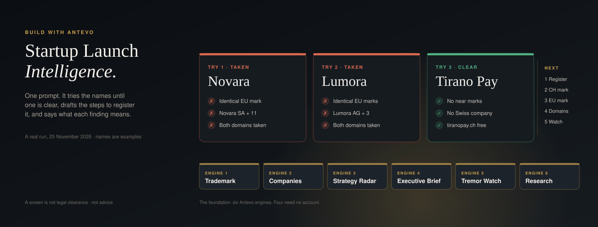

# Build with Antevo

**We build the intelligence. You build what's next.** This plugin connects six Antevo engines
to your assistant and adds builds on top of them: one prompt, the engines answer, and your
assistant joins the answers into a working document. The page: https://antevo.ch/mcp/build/

```text
/plugin marketplace add ANTEVO-CH/plugins
/plugin install antevo-build@antevo
```

Then ask: *"Help me launch an AI fintech in Switzerland, then Germany. My names are Novara,
Lumora and Tirano Pay."*

## Startup Launch Intelligence · skill `startup-launch`

One story, in four parts.

| | What happens | Engine |
|---|---|---|
| **1. The name, try by try** | Your names, in your order. Each one is screened across the trademark registers, the companies registered under it and its domains, and called **taken** or **clear on this screen**, with the evidence. It stops at the first clear name. If none is clear, it offers new ones and screens them. | Trademark |
| **2. Register it** | The steps for the clear name, in order, each with its official link: the commercial register, the trademark office at home and in the next market, the domains, then a watch on the name. | Trademark |
| **3. What the markets say, and so what** | Competition, market entry, costs and funding risk, each finding with its date and one line on what it means for the launch. | Companies · Strategy Radar · Research · Executive Brief · Tremor Watch |
| **4. The plan** | How the findings connect, a 90-day roadmap (options to consider) and the dates to watch. | all six |

### A real run, 25 November 2026

The idea: an AI fintech in Switzerland, then Germany. The names are examples, not suggestions.

- **Novara: taken.** Identical marks on file in the EU, one registered since 2012; Novara SA and 11 more Swiss companies; novara.ch and novara.com registered.
- **Lumora: taken.** Identical marks registered in the EU since 2023; Lumora AG and 3 more Swiss companies; both domains registered.
- **Tirano Pay: clear on this screen.** No near marks, no Swiss company, tiranopay.ch and tiranopay.com appear unregistered.
- **Next steps:** [zefix.ch](https://www.zefix.ch) and [easygov.swiss](https://www.easygov.swiss) for the company, [ige.ch](https://www.ige.ch/en/protecting-your-ip/trade-marks) for the Swiss mark, [euipo.europa.eu](https://euipo.europa.eu) for the EU mark, [nic.ch](https://www.nic.ch) for the domain, then an Antevo watch.
- **So what:** Germany comes second (business activity 55 against 46.2 in France); budget for euro-area costs (policy rate 2.5% against 0% at home); plan a longer runway (markets at 2.4 times a normal week, funding for tech tighter).


## The template

`template/` is one page that renders one file, `workspace.json`. The skill fills it; so can your
own agent. Restyle it, rename it, turn it into your own product.

```bash
cd template && python3 -m http.server 8000   # then open http://localhost:8000
```

The file's blocks are all optional, so the same page renders other builds too: `tries` (options
checked one by one), `steps` (next actions with links), `sections` (a finding, its `so_what`, its
evidence and source), `links`, `roadmap` and `watch`. See [template/README.md](template/README.md).

## The six engines

| Engine | Address | Access |
|---|---|---|
| Trademark | `https://trademark.antevo.ch/mcp` | free, no account |
| Strategy Radar | `https://api.antevo.ch/mcp/strategy/mcp` | free, no account |
| Executive Brief | `https://api.antevo.ch/mcp/executive/mcp` | free, no account |
| Tremor Watch | `https://api.antevo.ch/mcp/tremor/mcp` | free, no account |
| Companies | `https://api.antevo.ch/mcp/companies/mcp` | any Antevo account; finding is free, opening a file uses credits |
| Research | `https://api.antevo.ch/mcp/research/mcp` | any Antevo account; answers use credits |

Not on Claude? Add the six addresses to any MCP client and paste the recipe,
[antevo.ch/mcp/build/antevo-startup-launch.md](https://antevo.ch/mcp/build/antevo-startup-launch.md),
at the start of the conversation.

## More builds

The same six engines, a different building on top: M&A intelligence, real estate acquisition,
family office, due diligence and supply chain are next.

## The rules every build keeps

Every figure keeps its date, and Antevo's answers are quoted as Antevo's. A trademark screen is
not legal clearance, and an unregistered domain can be taken at any time. The plan is options to
consider, never investment, legal or tax advice. Nothing here trades, moves money or decides for you.
