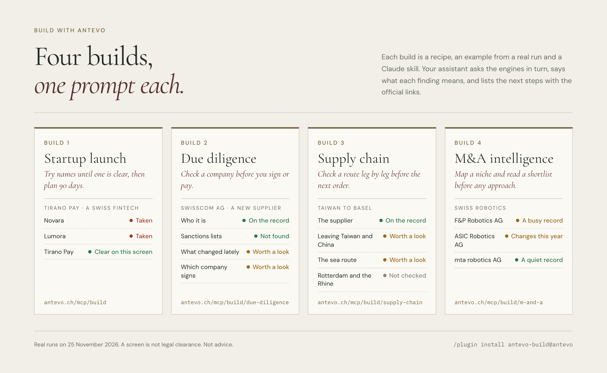
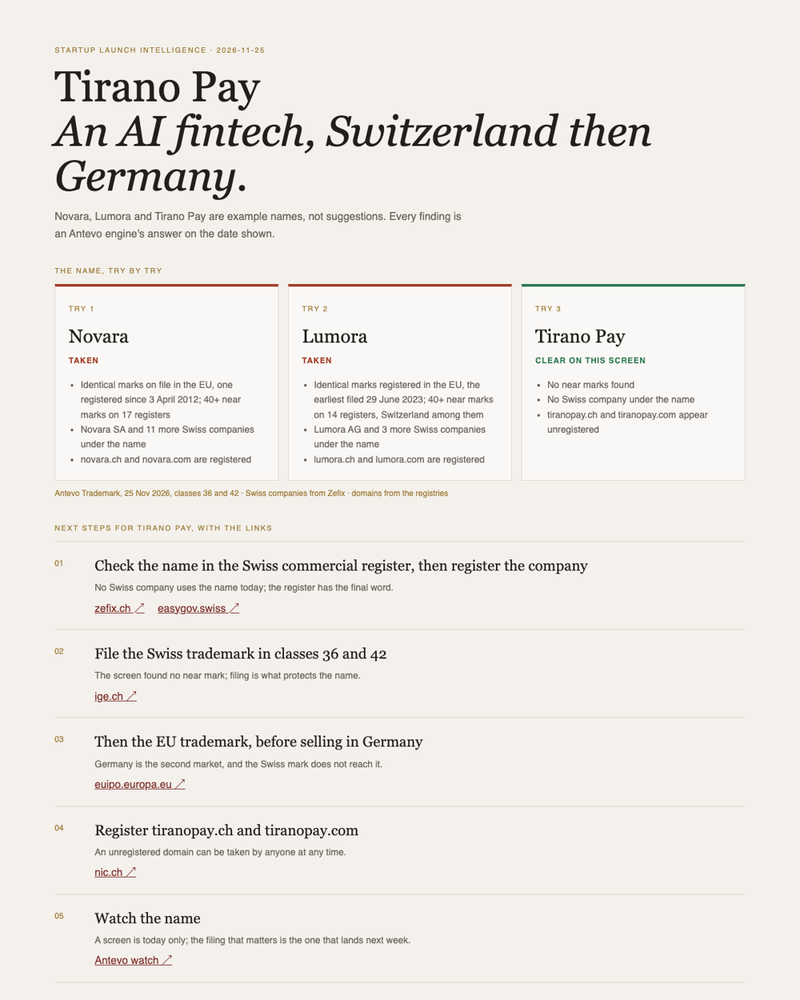

<picture>
  <source media="(prefers-color-scheme: dark)" srcset="../../assets/builds-dark.png">
  
</picture>

# Build with Antevo

**We build the intelligence. You build what's next.** This plugin connects seven Antevo engines
to your assistant and adds builds on top of them: one prompt, the engines answer, and your
assistant joins the answers into a working document. The page: https://antevo.ch/mcp/build/

```text
/plugin marketplace add ANTEVO-CH/plugins
/plugin install antevo-build@antevo
```

Then ask: *"Help me launch an AI fintech in Switzerland, then Germany. My names are Novara,
Lumora and Tirano Pay."* Or: *"Check Swisscom AG before we sign with them as a supplier."*

## Startup Launch Intelligence · skill `startup-launch`

One story, in four parts.

| | What happens | Engine |
|---|---|---|
| **1. The name, try by try** | Your names, in your order. Each one is screened across the trademark registers, the companies registered under it and its domains, and called **taken** or **clear on this screen**, with the evidence. It stops at the first clear name. If none is clear, it offers new ones and screens them. | Trademark |
| **2. Register it** | The steps for the clear name, in order, each with its official link: the commercial register, the trademark office at home and in the next market, the domains, then a watch on the name. | Trademark |
| **3. What the markets say, and so what** | Competition, market entry, costs and funding risk, each finding with its date and one line on what it means for the launch. | Companies · Strategy Radar · Research · Executive Brief · Tremor Watch |
| **4. The plan** | How the findings connect, a 90-day roadmap (options to consider) and the dates to watch. | all six |

### A real run, 25 November 2026

The idea: an AI fintech in Switzerland, then Germany. The names are examples, not suggestions.

- **Novara: taken.** Identical marks on file in the EU, one registered since 2012; Novara SA and 11 more Swiss companies; novara.ch and novara.com registered.
- **Lumora: taken.** Identical marks registered in the EU since 2023; Lumora AG and 3 more Swiss companies; both domains registered.
- **Tirano Pay: clear on this screen.** No near marks, no Swiss company, tiranopay.ch and tiranopay.com appear unregistered.
- **Next steps:** [zefix.ch](https://www.zefix.ch) and [easygov.swiss](https://www.easygov.swiss) for the company, [ige.ch](https://www.ige.ch/en/protecting-your-ip/trade-marks) for the Swiss mark, [euipo.europa.eu](https://euipo.europa.eu) for the EU mark, [nic.ch](https://www.nic.ch) for the domain, then an Antevo watch.
- **So what:** Germany comes second (business activity 55 against 46.2 in France); budget for euro-area costs (policy rate 2.5% against 0% at home); plan a longer runway (markets at 2.4 times a normal week, funding for tech tighter).



## Company Due Diligence · skill `due-diligence`

Before you sign, pay or partner. One prompt, four engines, three of them free with no account.
The page: https://antevo.ch/mcp/build/due-diligence/

| | What happens | Engine |
|---|---|---|
| **1. Check by check** | Five checks in turn, each **on the record**, **worth a look**, **mismatch** or **not checked**: is it who it says it is, is it on a sanctions list, do the website and email add up, what changed lately, which company signs. | Companies · Guard · Trademark |
| **2. Before you sign** | What to settle, in order, each with its official link: today's register extract, the UID, the sanctions search, a call on a number you already hold for the bank details, then a watch on the company. | Companies |
| **3. What it means** | Who is behind it, its brand and its market today, each with one "so what" line. | Companies · Trademark · Strategy Radar |

### A real run, 25 November 2026

The deal: a new supplier, checked before signing. Swisscom AG is an example chosen because it is
well known; nothing is alleged.

- **On the record:** active in the Swiss register (CHE-102.753.938, Ittigen), LEI issued; not found on the OFAC, EU, UK or SECO lists; swisscom.ch has had certificates since 2008.
- **Worth a look:** signatories changed on 6 May and 30 June 2026; several Swiss companies carry the name and the trademarks sit with Swisscom (Schweiz) AG.
- **Before you sign:** [zefix.ch](https://www.zefix.ch) for today's extract, [uid.admin.ch](https://www.uid.admin.ch) so the contract and invoice name the same company, the bank details confirmed by phone, [the SECO search](https://www.sesam.search.admin.ch) if your rules need it, then an Antevo watch.
- **So what:** no controlling parent on record, so ask for the beneficial-owner declaration if onboarding needs owners; for a multi-year cloud contract, ask how prices are fixed if funding gets dearer.

The workspace: `template/index.html?w=due-diligence.json`.

## Supply Chain Watch · skill `supply-chain`

Before the next order. One prompt, four engines, three of them free with no account.
The page: https://antevo.ch/mcp/build/supply-chain/

| | What happens | Engine |
|---|---|---|
| **1. Leg by leg** | The supplier, leaving the origin, the route, the last mile, fuel and freight, each **running**, **worth a look**, **disrupted** or **not checked**. | Guard · Executive Brief · Strategy Radar · Research |
| **2. Before the next order** | What to settle, each with its official link: the supplier's register, a price clause or a second supplier, stock, the route and the river, the duty, the daily board. | Strategy Radar |
| **3. What it means** | Tariffs and export curbs, what could change the route, fuel and the dated events ahead, each with one "so what" line. | Strategy Radar · Executive Brief |

### A real run, 25 November 2026

Electronic components from Taiwan to a Swiss machine maker, by sea to Rotterdam and up the
Rhine to Basel. The machine maker is an example; the supplier is named only to show the check.

- **Leg 1, on the record:** the supplier's domain was registered in 2001 and points to a web server; Taiwan's register is not covered by Guard yet.
- **Legs 2, 3 and 5, worth a look:** China's pause on critical-material export curbs runs to January as new US tariffs are readied; the Red Sea's southern gate borders Yemen, third on Antevo's hotspot list; Brent rebounded to 91.40 dollars on 24 November.
- **Leg 4, not checked:** Antevo's shipping desk did not answer that morning, so the Rhine leg says so instead of guessing, and links the [river gauges](https://www.pegelonline.wsv.de) and the [Swiss Rhine ports](https://port-of-switzerland.ch).
- **So what:** the tariff risk and the export-curb risk are one risk with one date, January; ask the forwarder to price both routes, Suez and the Cape.

The workspace: `template/index.html?w=supply-chain.json`.

## M&A Intelligence · skill `m-and-a`

Before you call anyone. One prompt, five engines, three of them free with no account.
The page: https://antevo.ch/mcp/build/m-and-a/

| | What happens | Engine |
|---|---|---|
| **1. Map the niche** | Who is registered under the niche word: names, legal forms, seats, counted. | Companies |
| **2. The shortlist** | Each company's file: register status, dated notices, group, sanctions lists, and who holds which brands; each **a quiet record**, **worth a look**, a **mismatch** or **not checked**. | Companies · Trademark |
| **3. Before a first approach** | The register extract, the notices themselves, patents and designs, owners under a confidentiality agreement, then a watch. | Companies · Trademark |
| **4. The deal climate** | Financing and the currency, market strain and the niche's market, each with one "so what" line. | Research · Tremor Watch · Strategy Radar |

### A real run, 25 November 2026

Swiss robotics. The companies are public register entries, read to show how a buyer works:
nothing says any of them is for sale or has been approached.

- **The niche:** the first ten register matches, seats from Geneva to Ticino.
- **The shortlist:** F&P Robotics AG (24 notices since 2019, four this year; one EU trademark pending), ASIC Robotics AG (three notices this year; no trademark filings in the registers read), mta robotics AG (a quiet record).
- **Before a first approach:** [zefix.ch](https://www.zefix.ch) for the extracts, the notices on [shab.ch](https://www.shab.ch), [Swissreg](https://www.swissreg.ch) for patents and designs, owners asked under a confidentiality agreement, then a watch.
- **So what:** financing is cheap but starting to rise (SNB 0.00%, next assessment 10 December); markets are elevated at 2.4 times a normal week, so a price can move before signing; German factories are expanding, so ask for order intake since September.

The workspace: `template/index.html?w=m-and-a.json`.

## The template

`template/` is one page that renders one file, `workspace.json`. The skill fills it; so can your
own agent. Restyle it, rename it, turn it into your own product.

```bash
cd template && python3 -m http.server 8000   # then open http://localhost:8000
```

The file's blocks are all optional, so the same page renders other builds too: `tries` (options
checked one by one), `steps` (next actions with links), `sections` (a finding, its `so_what`, its
evidence and source), `links`, `roadmap` and `watch`. `index.html?w=due-diligence.json`,
`index.html?w=supply-chain.json` and `index.html?w=m-and-a.json` render the other runs. See [template/README.md](template/README.md).

## The seven engines

| Engine | Address | Access |
|---|---|---|
| Trademark | `https://trademark.antevo.ch/mcp` | free, no account |
| Guard | `https://api.antevo.ch/mcp/guard/mcp` | free, no account |
| Strategy Radar | `https://api.antevo.ch/mcp/strategy/mcp` | free, no account |
| Executive Brief | `https://api.antevo.ch/mcp/executive/mcp` | free, no account |
| Tremor Watch | `https://api.antevo.ch/mcp/tremor/mcp` | free, no account |
| Companies | `https://api.antevo.ch/mcp/companies/mcp` | any Antevo account; finding is free, opening a file uses credits |
| Research | `https://api.antevo.ch/mcp/research/mcp` | any Antevo account; answers use credits |

Not on Claude? Add the addresses to any MCP client and paste a recipe at the start of the
conversation: [antevo-startup-launch.md](https://antevo.ch/mcp/build/antevo-startup-launch.md),
[antevo-due-diligence.md](https://antevo.ch/mcp/build/due-diligence/antevo-due-diligence.md),
[antevo-supply-chain.md](https://antevo.ch/mcp/build/supply-chain/antevo-supply-chain.md) or
[antevo-m-and-a.md](https://antevo.ch/mcp/build/m-and-a/antevo-m-and-a.md).

## More builds

The same engines, a different building on top: real estate acquisition and family office
are next.

## The rules every build keeps

Every figure keeps its date, and Antevo's answers are quoted as Antevo's. A trademark screen is
not legal clearance, and an unregistered domain can be taken at any time. An M&A read never says a company is for sale and never guesses why a notice was filed. A quiet week on a route means no alerts in the sources read, never a safe route. The plan is options to
consider, never investment, legal or tax advice. A due-diligence read is public records only:
not a KYC, AML or sanctions-compliance screen, not a credit report, and never about a person's conduct. Nothing here trades, moves money or decides for you.
