# Antevo Research

Antevo's research desks in Claude. Put a question to one of eighteen desks and
get the desk's own written answer, built from the research and news it reads
every day, with every fact dated.

Economy · geopolitics · shipping · real estate · strategy · commodities ·
markets · technology · digital assets · health · rates · mortgages · equities ·
technical · ETFs · results · the Swiss market · private markets

`https://api.antevo.ch/mcp/research/mcp` — any Antevo account, OAuth sign-in on
first use.

```text
/plugin marketplace add ANTEVO-CH/plugins
/plugin install antevo-research@antevo
```

## Skills

| Skill | What it does |
|:--|:--|
| `/antevo-research:ask-a-desk` | One question to the desk that covers it, with the answer's dates and how recent its reading is |
| `/antevo-research:joined-up-view` | A question across two or three desks, or the strategy desk, set side by side: where they agree and where they differ |
| `/antevo-research:company-read` | A listed company across the equities, results and, on request, technical desks; the Swiss desk for a Swiss company |

## What it will not do

It reads and writes an answer; it changes nothing. It is editorial research, not
investment advice: it never tells you to buy, sell or hold, gives no ratings or
price targets, and the technical desk never gives a price level a market is
expected to reach. It can't see your holdings; for what something means for
your own money, use `antevo-wealth`.

Step by step: <https://antevo.ch/research/> · Support: contact@antevo.ch
